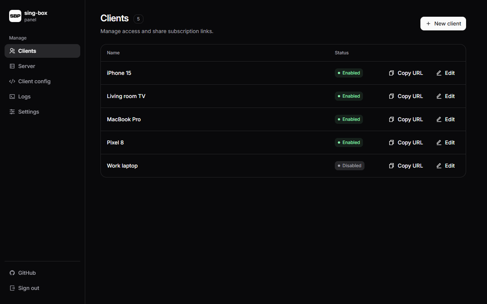
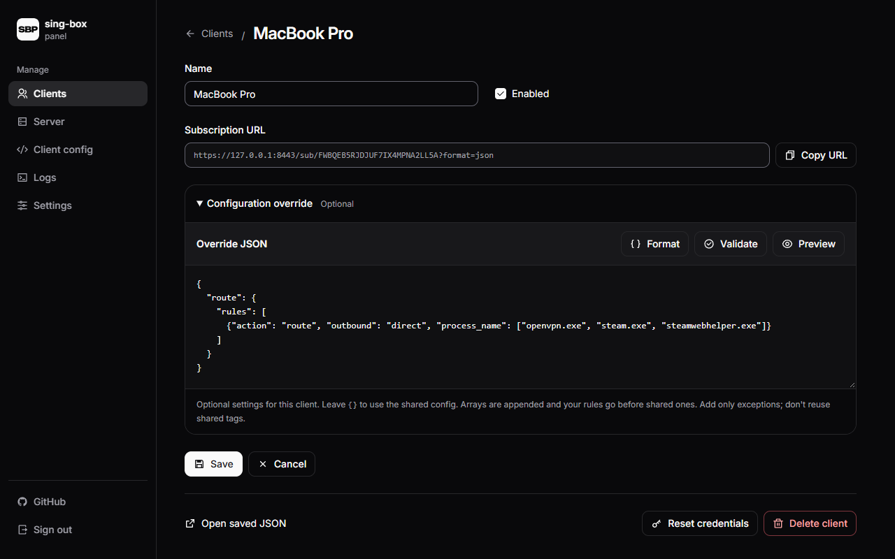
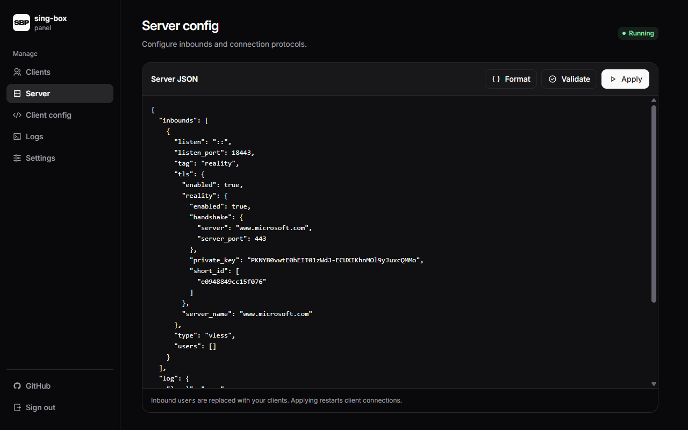
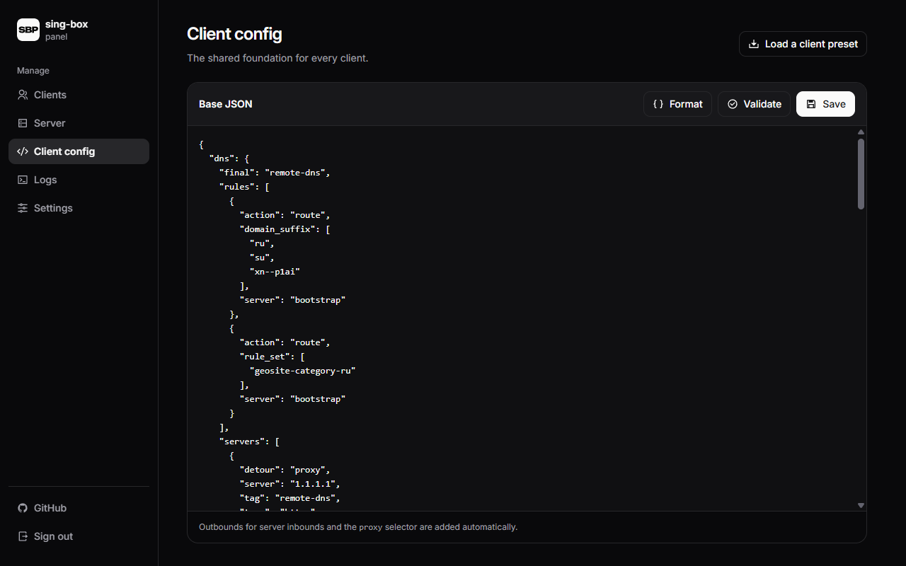
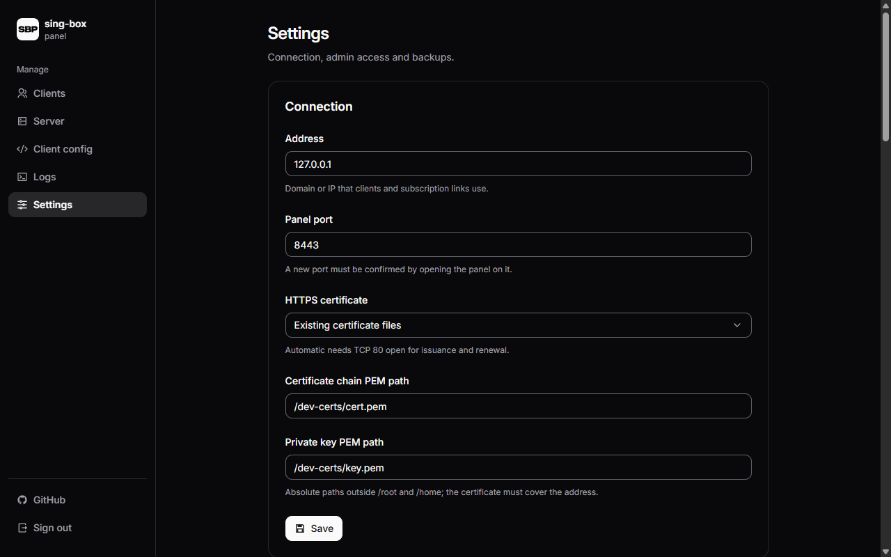

# sing-box-panel

Web panel for a [sing-box](https://sing-box.sagernet.org/) proxy server. Create clients and import their subscription URLs into a sing-box app on your phone or computer to load connection settings.

- One-command installation and updates; automatic HTTPS for domains and public IPs.
- Routing presets, ad blocking, and editable JSON checked before use.
- Web and SSH backups. No separate database service.



<details>
<summary>More screenshots</summary>









</details>

## Before you start

- A Linux server (VPS): systemd, **amd64** or **arm64**, public IP. An optional domain must point to it.
- SSH access with root privileges and `curl` installed.
- These incoming TCP ports open in both the server firewall and your hosting provider's firewall:

| Port | Purpose |
| --- | --- |
| **80** | Automatic HTTPS certificates; keep open for renewal |
| **443** | Default proxy connection port |
| **8443** | Web panel and subscription URLs |

Ports must be free. For custom ports, see **Settings → Firewall ports**.

## Prepare the server

Connect over SSH. Run commands **on the server as root** (`sudo -i` if needed).

<details>
<summary>Ubuntu / Debian: install prerequisites if missing</summary>

```bash
apt update
apt install -y curl ca-certificates passwd
```

</details>

## Install

```bash
bash <(curl -fsSL https://raw.githubusercontent.com/chok8356/sing-box-panel/master/install.sh)
```

Enter your **public IP or domain**, keep port **8443**, and choose certificate mode **auto**. Both the panel and sing-box start automatically.

Show the panel address, login, and initial password:

```bash
sbp url
grep ADMIN_PASSWORD /etc/sing-box-panel/panel.env
```

## Connect your first device

Open the full `sbp url` address in your browser and sign in.

1. **Settings → Certificate:** wait for **HTTPS ready**. If it fails, check port **80** and `sbp logs`; remote profiles need a trusted certificate.
2. **Server:** keep the defaults and click **Create VLESS + Reality**.
3. **Client config → Load a client preset:** choose **All traffic through proxy**, click **Load into editor**, then **Save**. Ad blocking is optional.
4. **Clients → New client:** enter a name, click **Create client**, then **Copy URL**.
5. Import the URL as a **remote profile** in an app using sing-box **1.14+** on your device, then connect.

Keep subscription URLs secret: they grant proxy access. Refresh the app's remote profile after changing client settings.

Per-client domain and process exceptions go in **Configuration override**, before the shared routing rules.

After connecting, compare speeds with and without the proxy using the same download or test server.

<details>
<summary>Speed much lower through the proxy? Try TCP BBR (Ubuntu / Debian)</summary>

BBR can improve TCP throughput on high-latency or lossy routes; the gain depends on your network. See the [BBR documentation](https://github.com/google/bbr/blob/master/Documentation/bbr-quick-start.md).

Run on the server **as root** (`sudo -i` if needed). First check the current setting:

```bash
sysctl net.ipv4.tcp_congestion_control
```

If it already shows `bbr`, it is enabled; no change is needed. Otherwise, check kernel support:

```bash
modprobe tcp_bbr
sysctl net.ipv4.tcp_available_congestion_control
```

Continue only if the list includes `bbr`. If the module is unavailable and `bbr` is missing, ask your hosting provider about kernel support.

Save and apply the settings:

```bash
cat > /etc/sysctl.d/99-bbr.conf <<'EOF'
net.core.default_qdisc=fq
net.ipv4.tcp_congestion_control=bbr
EOF
sysctl -p /etc/sysctl.d/99-bbr.conf
```

Verify:

```bash
sysctl net.ipv4.tcp_congestion_control net.core.default_qdisc
```

Expect `bbr` and `fq`. Settings persist across reboots. Reconnect your client app to use BBR on new TCP connections, then repeat the same speed test. BBR does not fix every cause of low speed.

</details>

## Update

```bash
sbp update
```

Keeps settings and clients. For a specific release: `sbp update vX.Y.Z`. Run as root.

<details>
<summary>Install or update from a file</summary>

Download `sing-box-panel_linux_amd64` (or `_arm64`) from [Releases](https://github.com/chok8356/sing-box-panel/releases). Upload it to `/tmp/sbp` on the server. As root, run `chmod 700 /tmp/sbp`, then `/tmp/sbp install` or `sbp update --file /tmp/sbp`.

</details>

## Backup and restore

**Settings → Backup and restore** saves/restores clients, configurations, and access settings as `.db`. SSH recovery: `sbp restore /path/to/backup.db` as root.

`sbp backup` saves an archive and `.sha256` in `/var/backups/sing-box-panel`. Copy both off-server. Restore with `sbp restore /path/to/backup.tar.gz`; keep `.sha256` beside it.

Restoring replaces current settings and clients. Backups do not include certificates.

## Useful commands

Run on the server as root:

| Command | Purpose |
| --- | --- |
| `sbp url` | Show panel address and login information |
| `sbp status` | Check whether the service is running |
| `sbp logs` | Follow logs; press Ctrl+C to exit |
| `sbp start` / `sbp stop` / `sbp restart` | Control the service |
| `sbp reset-password` | Reset the admin password if locked out |
| `sbp uninstall` | Remove the program; keep data, settings, and backups |
| `sbp help` | Show all commands |

## Development

<details>
<summary>Local preview and tests</summary>

```bash
docker compose up --build
```

Open `https://localhost:8443/panel/` (login `admin` / `test`; self-signed certificate). Templates and CSS reload on refresh. `docker compose watch` rebuilds on Go changes; `go test ./...` runs tests.

</details>

[Releases](https://github.com/chok8356/sing-box-panel/releases) · [Third-party components](THIRD_PARTY.md) · [MIT](LICENSE)
